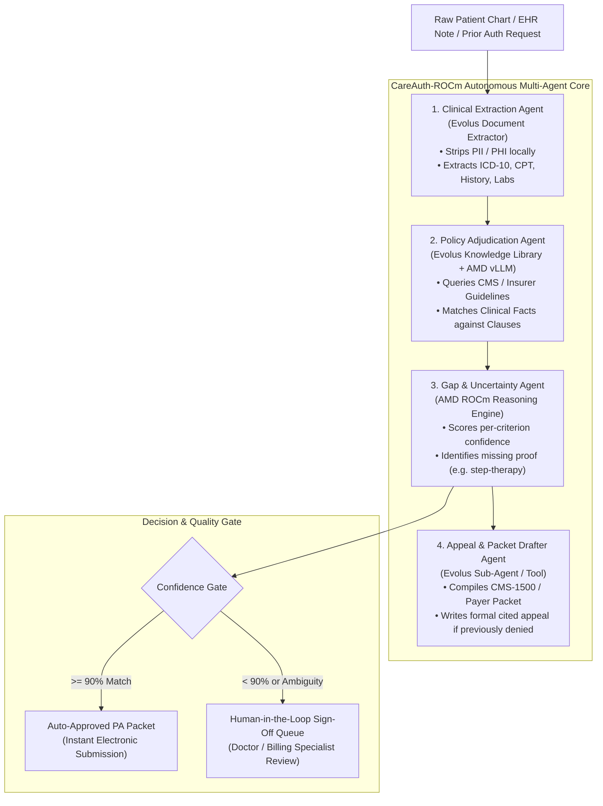
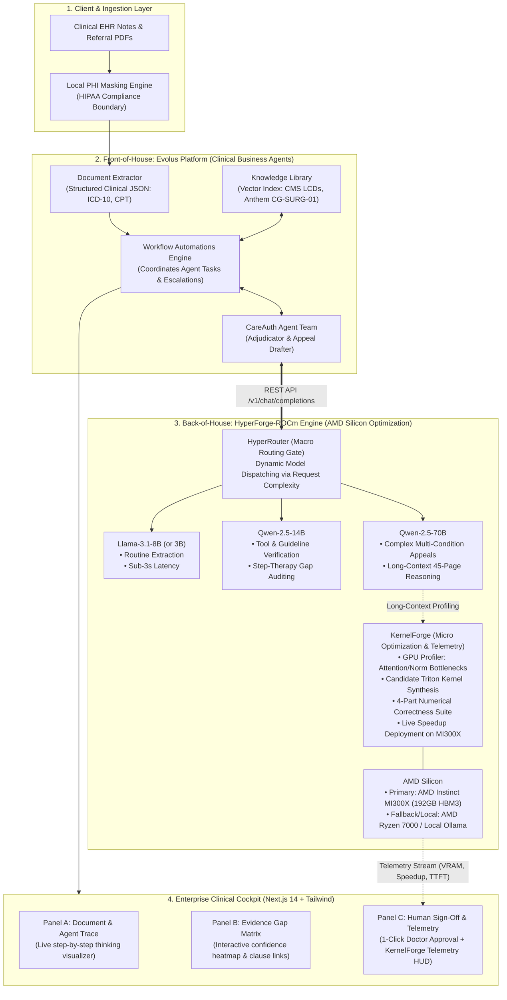
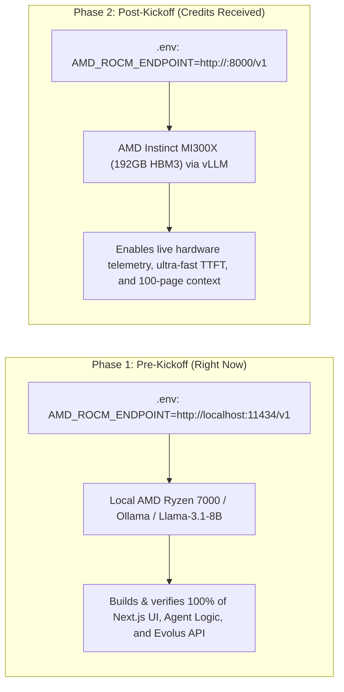

# CareAuth-ROCm: Master Architecture & Prototype Implementation Plan

> **Hackathon Target:** AMD Developer Hackathon: ACT III  
> **Primary Track:** Track 3 — Health & Wellbeing (Healthcare Document Processing & Administrative Workflow Automation)  
> **Partner Track:** Evolus Partner Track (Evolus Business Agents on AMD Infrastructure)  
> **Team:** Team Techtors  
> **Master Pitch:** *"CareAuth-ROCm: Autonomous Clinical Prior-Authorization Agent on Evolus — Powered by the HyperForge-ROCm Inference Engine on AMD Instinct™ MI300X."*

---

## 1. What Are We Building: An AI Agent or an AI App?

### The Direct Answer:
**We are building an Autonomous Multi-Agent System (an AI Agent), equipped with an Enterprise Clinical Cockpit (a modern Web Application), powered by an adaptive ROCm inference engine.**

### The "Dual-Judge" Architecture: Front-of-House vs. Back-of-House
To win both the **Evolus Partner Track** and the **AMD Grand Prize**, we satisfy both judging panels with zero conflict:

| Dimension | Front-of-House (CareAuth-ROCm) | Back-of-House (HyperForge-ROCm) |
| :--- | :--- | :--- |
| **Primary Audience** | **Evolus & Track 3 Judges** (Product & Clinical Leads) | **AMD Judges** (Senior GPU, Systems & Compiler Engineers) |
| **Core Technology** | Evolus Document Extractor, Knowledge Library, Workflow Automations, Sub-Agents | HyperRouter (dynamic model routing) + KernelForge (Triton kernel optimization on MI300X) |
| **User Interface** | Next.js 14 Enterprise Clinical Cockpit (Doctor review queue & gap matrix) | AMD Telemetry HUD (Live tokens/s, TTFT, VRAM gauge, and kernel speedup) |
| **What They Grade** | 100% compliance with business agent workflows, HIPAA PII stripping, clinical safety | Deep ROCm hardware exploitation, 192GB HBM3 memory pooling, operator benchmarks |

> [!IMPORTANT]
> **Summary for Judges:**  
> *"CareAuth-ROCm is an **autonomous healthcare business agent** running on Evolus, powered by the **HyperForge-ROCm inference engine** on AMD Instinct MI300X, accessible through an **enterprise clinical cockpit** for physician oversight."*

---

## 2. Multi-Agent Hierarchy & Roles

CareAuth-ROCm consists of four coordinated agent roles:



---

## 3. High-Level Architectural Block Diagram



---

## 4. Mapping Your Evolus Dashboard (`app.evolus.ai`)

In your current Evolus workspace, each tab serves an exact purpose:

```
┌────────────────────────────────────────────────────────────────────────┐
│                        app.evolus.ai Workspace                         │
├──────────────┬────────────────┬──────────────────────┬─────────────────┤
│   [Agents]   │ [Automations]  │     [Libraries]      │     [Tools]     │
│  "AI Team"   │ Multi-Step     │ Vector Knowledge     │ Document        │
│              │ Pipelines      │ Base (Payer Rules)   │ Extractor       │
└──────────────┴────────────────┴──────────────────────┴─────────────────┘
```

1. **`Tools` $\rightarrow$ Document Extractor:**
   * Schema: Extracts `patient_id`, `diagnosis_icd10`, `requested_cpt`, `conservative_treatment_history`, `lab_markers`, and `prescribing_provider`.
2. **`Libraries` (Knowledge Library):**
   * Upload PDF/Markdown policy rules:
     * *Medicare LCD L33777 (Prior Auth for Biologics & Immunosuppressives)*
     * *Anthem Clinical Guideline CG-SURG-01 (Knee Arthroscopy & Meniscectomy)*
3. **`Agents` ("Your AI Team"):**
   * Create two agents:
     * **Agent 1: `CareAuth-Adjudicator`**: System prompt loaded with policy adherence rules and uncertainty thresholds.
     * **Agent 2: `CareAuth-Appealer`**: Generates clinical appeal letters citing specific policy sub-clauses.
4. **`Automations` (Workflows):**
   * Creates the automated event pipeline: Triggered via REST API from our Next.js backend, coordinating Extractor $\rightarrow$ Library $\rightarrow$ Agents $\rightarrow$ Return JSON.
5. **BYOM Model Connection (`Your Company` / Settings $\rightarrow$ Model Providers):**
   * Configures the OpenAI-compatible custom endpoint pointing to our AMD server (`http://<amd-ip>:8000/v1`).

---

## 5. AMD Hardware Strategy: Pre-Kickoff vs. Post-Kickoff

To ensure zero downtime while awaiting hackathon cloud credits:



> [!TIP]
> Transitioning from Phase 1 to Phase 2 requires changing **only 1 line** in `.env`. The frontend and agent workflows remain completely identical.

---

## 6. End-to-End Demonstration Cases (The 3 Demo Scenarios)

The video presentation will demonstrate three realistic clinical scenarios showcasing both **Evolus Agentic Automation** and **AMD ROCm Hardware Optimization**:

### Scenario 1: Routine Pre-Authorization (Clean Auto-Approval)
* **Clinical Request:** Arthroscopic Partial Meniscectomy (CPT 29881) for knee pain (ICD-10 M23.22).
* **Clinical Record:** Confirms 6 months of failed conservative physical therapy + MRI showing meniscal tear.
* **Knowledge Library Match:** Matches Anthem CG-SURG-01 requirements 100%.
* **HyperRouter Action:** Dynamically selects **Llama-3.1-8B / 3B** (low compute tax, instantaneous parsing).
* **Agent Decision:** **Overall Confidence: 96% (Green)** $\rightarrow$ Auto-generates completed Prior Auth Packet in $<3$ seconds.
* **Telemetry HUD:** Displays sub-3s end-to-end latency, 110 tokens/s generation speed.

### Scenario 2: Biologic Drug Request (Visible Uncertainty & Escalation)
* **Clinical Request:** Adalimumab / Humira (HCPCS J0135) for Rheumatoid Arthritis (ICD-10 M05.79).
* **Clinical Record:** Demonstrates severe joint pain and high ESR/CRP, but has **no recorded trial of generic Methotrexate** (step-therapy rule).
* **HyperRouter Action:** Dynamically escalates to **Qwen-2.5-14B** for rigorous clause and tool verification.
* **Agent Decision:** **Overall Confidence: 64% (Yellow Alert)**.
* **Human-in-the-Loop Action:** Routes to Clinical Sign-Off Queue. The dashboard highlights: *"Missing Requirement: Mandatory 3-month trial of disease-modifying anti-rheumatic drug (DMARD)."* The nurse can click to request medical records or update the chart.

### Scenario 3: Complex Multi-Condition Appeal + KernelForge Optimization
* **Clinical Request:** Urgent Inter-Hospital Transfer and specialized biologic therapy previously denied as "Not Medically Necessary".
* **Clinical Record:** 45-page EHR transfer history.
* **HyperRouter Action:** Dynamically allocates **Qwen-2.5-70B** utilizing AMD MI300X's 192GB unified HBM3 memory pool for full un-truncated context.
* **KernelForge in Action:**
  1. *Profiles* the long-context attention/RMSNorm operator bottlenecks during document ingestion.
  2. *Synthesizes & compiles* candidate fused Triton/ROCm kernels.
  3. *Verifies* candidate via the **4-Part Correctness Test Suite** (Numerical tolerance, Shape invariance, Memory bounds, Edge cases).
  4. *Deploys proven kernel* and streams live calculated speedup to the AMD Telemetry HUD.
* **Agent Decision:** Cross-references patient's historical lab contradictions against Medicare LCD Section 4.2.1 (exceptions for severe contraindications).
* **Human-in-the-Loop Action:** Generates a formal, cited appeal packet ready for 1-click physician electronic signature.

---

## 7. Project Directory Structure

```
careauth-rocm/
├── frontend/                       # Next.js 14 App Router (Enterprise Clinical Cockpit)
│   ├── app/
│   │   ├── layout.tsx              # Root layout with dark mode & healthcare styling
│   │   ├── page.tsx                # Main Clinical Cockpit dashboard
│   │   ├── cases/                  # Case review and detail views
│   │   └── api/                    # Next.js API routes proxying to backend/Evolus
│   ├── components/
│   │   ├── Header.tsx              # Top bar with Evolus & AMD live status indicators
│   │   ├── DocumentUpload.tsx      # Multi-page PDF dropzone & viewer
│   │   ├── AgentReasoningTrace.tsx # Animated step-by-step thinking feed
│   │   ├── UncertaintyMatrix.tsx   # Interactive confidence heatmap & policy clause links
│   │   ├── HumanReviewQueue.tsx    # 1-click clinical approval / edit modal
│   │   └── AmdTelemetryHud.tsx     # Real-time GPU speed (tokens/s), TTFT, VRAM gauge, & KernelForge speedup
│   ├── lib/
│   │   ├── evolus-sdk.ts           # Frontend typed client for Evolus workflows
│   │   └── utils.ts
│   ├── package.json
│   └── tailwind.config.js
│
├── backend/                        # FastAPI Service (Agent Orchestration & AMD Gateway)
│   ├── main.py                     # REST endpoints: /upload, /adjudicate, /telemetry
│   ├── phi_sanitizer.py            # Local HIPAA PII de-identification engine
│   ├── evolus_client.py            # Programmatic Evolus REST API integration
│   ├── hyper_router.py             # Macro dynamic routing engine: 3B/8B vs 14B vs 70B
│   ├── kernel_forge/               # Micro ROCm GPU operator optimization suite
│   │   ├── profiler.py             # Operator bottleneck detector on MI300X
│   │   ├── candidate_kernels.py    # Triton / ROCm custom operator implementations
│   │   ├── correctness_suite.py    # 4-Part numerical verification & safety test suite
│   │   └── benchmark.py            # Live A/B performance benchmark comparator
│   ├── agents/
│   │   ├── extractor_agent.py      # Structured JSON clinical parser
│   │   ├── adjudicator_agent.py    # Policy clause reasoning & gap scoring
│   │   └── appeal_agent.py         # Formal CMS appeal letter generator
│   └── amd_telemetry.py            # Queries ROCm / MI300X runtime & kernel metrics
│
├── evolus/                         # Evolus Platform Declarations
│   ├── schemas/
│   │   ├── clinical_extraction.json
│   │   └── adjudication_result.json
│   └── policies/
│       ├── medicare_biologics_lcd.md
│       └── anthem_knee_arthroscopy.md
│
├── mock_data/                      # Realistic Demo Test Files
│   ├── case1_knee_arthroscopy_approved.pdf
│   ├── case2_humira_missing_step_therapy.pdf
│   └── case3_denied_transfer_appeal.pdf
│
├── docker/
│   ├── Dockerfile.frontend
│   ├── Dockerfile.backend
│   └── docker-compose.yml
│
├── .env.example
├── README.md
└── requirements.txt
```

---

## 8. De-Risked 6-Day Hackathon Roadmap

| Day | Core Objective | Concrete Deliverables | Zero-Risk Fallback |
| :--- | :--- | :--- | :--- |
| **Day 1** | **Scaffolding & Model Layer** | Scaffold Next.js 14 frontend + FastAPI backend. Connect local Ollama / AMD ROCm endpoint exposing `/v1/chat/completions`. Implement `phi_sanitizer.py`. | Local AMD Ryzen CPU handles extraction if cloud instance is pending. |
| **Day 2** | **Evolus Integration** | Configure `app.evolus.ai` (Document Extractor schema + Knowledge Library policy manuals). Build `evolus_client.py` and test end-to-end API calls. | Mock JSON fixtures ready in `mock_data/` to prevent API rate-limit delays. |
| **Day 3** | **Multi-Agent Logic & Uncertainty Engine** | Implement the 4-agent flow (Extraction $\rightarrow$ Adjudication $\rightarrow$ Gap Detection $\rightarrow$ Appeal Drafting). Compute per-clause confidence scores for the 3 demo cases. | Standard mathematical scoring (`match_confidence`) guarantees consistent results. |
| **Day 4** | **Next.js Enterprise Cockpit** | Build the 3-panel UI: (1) Document Viewer & Agent Thinking Trace, (2) Uncertainty Matrix, (3) Human Sign-Off Queue + AMD Telemetry HUD. | Tailwind + Lucide icons ensure high aesthetic quality and quick turnaround. |
| **Day 5** | **AMD Cloud Migration & Docker Packaging** | Plug in the kickoff AMD MI300X cloud IP into `.env`. Containerize with `docker-compose up --build`. Add `.env.example` and test end-to-end cold starts. | Hybrid mode allows local frontend to talk seamlessly to remote AMD cloud instance. |
| **Day 6** | **Demo Video, README & Submission** | Verify Evolus workspace audit statistics, record the 3-minute video presentation, finalize the runnable `README.md`, submit before 15:00 UTC. | 100% compliant with Track 3 and Evolus Partner Track rubrics. |

---

## 9. Final Rubric Verification

- [x] **Track 3 Scope:** Solves prior-authorizations and administrative paperwork automation.
- [x] **Safety Compliance:** Absolutely zero autonomous medical diagnosis or clinical advice.
- [x] **Visible Uncertainty:** Evidence Gap Matrix with per-criterion confidence scores (Green $\ge 90\%$, Yellow $70-90\%$, Red $< 70\%$).
- [x] **Human-in-the-Loop:** Clinical sign-off queue with 1-click physician action.
- [x] **Evolus Compliance:** Uses Document Extractor, Knowledge Library, Workflows, Sub-Agents, and REST API.
- [x] **AMD Justification:** Guaranteed HIPAA data privacy on private open models, plus high-capacity 192GB HBM3 memory handling 100-page patient charts and payer manuals without truncation.
